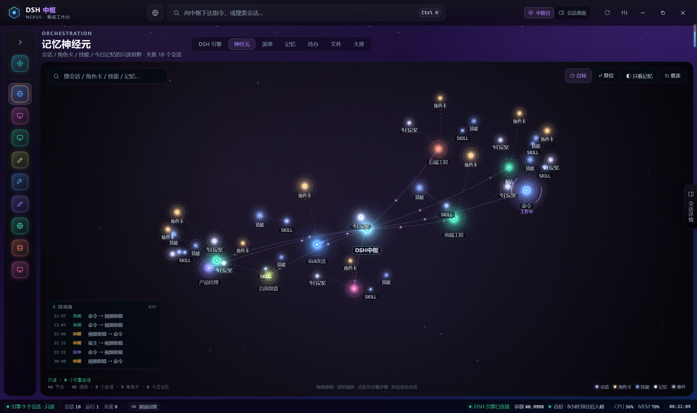

# DSH 中枢 · 集成工作台

一个围绕 DSH 引擎的本地桌面工作台：Electron 负责窗口、终端、文件与系统能力，React 负责会话桌面、盒子布局和模块装配。它不替代对话客户端，而是把 DSH 的会话、记忆、技能与本机工具投射到一块可编排的桌面上。



- 代码仓库：<https://github.com/sessionhive/dsh-workbench>
- 完整文档：[docs/文档索引.md](docs/文档索引.md)
- 协作插件：[sessionhive/dsh-collab](https://github.com/sessionhive/dsh-collab)

> 仓库只包含工作台外壳，不包含 DSH 引擎本体。首次部署需要网络；没有引擎时由一键脚本下载。

## 功能一览

- **中枢台**：左侧会话栏加中心视图，引擎、文件、待办、神经元、网页、记忆、终端、派单与运行状态按会话启用和排序。
- **会话桌面**：每个会话一块 12 列网格桌面，用盒子自由拼装，支持拖拽、缩放、专注、添加/移除、收纳和 `Ctrl + S` 保存。
- **引擎托管**：启动时拉起 `dsh web --no-open --port 3083`，抓取 token 地址嵌入 webview，退出时收掉进程树。
- **浏览器收纳**：顶栏独立地址册，二级窗口关闭后只挂起并保留页面状态，彻底释放才重新加载。
- **语音播报**：朗读当前会话的最新回复，可选本地 GPT-SoVITS 复刻音色或 16 套 Edge 神经音色，支持暂停、继续与停止。
- **十套主题与六种风格**：曜石黑、深空青、月夜蓝、晨雾白、森屿绿、樱粉、星紫、纸稿、琉璃、星河；支持标准 / 纸稿 / 粗野 / 终端 / 柔光 / 玻璃六种风格，以及渐变、贴纸或视频背景、文字色与圆角/纹理/字体/阴影等微调。
- **协作数据**：通过 dsh-collab 读取角色卡、总结、按日记忆、技能与工单，并遵守只读边界。

会话桌面示例：


## 环境要求

- Windows 10 / 11，或 Linux x86_64（AppImage / deb）
- Node.js 20 或更高版本
- 首次部署需要网络；已有 DSH 引擎可以跳过下载

## 快速开始

推荐把仓库放在 `<root>/app`，其余目录由一键脚本创建（root推荐命名：Workbench）：

```text
<root>/
├─ app/            工作台仓库（本仓库）
├─ engines/        DSH 引擎（apps/cli/lib/bin.js）
├─ data/.dsh/      引擎数据（_meta/registry.json）
├─ workspace/      会话工作目录
└─ _dev/tools/     工具目录
```

```powershell
git clone https://github.com/sessionhive/dsh-workbench.git app
cd app
node scripts/setup.mjs
```

Windows 也可以双击 `scripts\setup.cmd`。脚本会创建 `engines / data/.dsh / workspace / _dev/tools`，安装并构建工作台，下载 DSH，初始化数据目录，安装 dsh-collab，备份并更新 `cordis.patch.yml`，最后启动客户端。先预览流程用 `node scripts/setup.mjs --dry-run`。

手动安装：

```powershell
npm install
npm run build
npm start
```

已有引擎时，把引擎装到 `<root>/engines`、数据放进 `<root>/data/.dsh` 即可使用默认路径；也可以按 [引擎与插件](docs/引擎与插件.md) 用设置页或环境变量覆盖。dsh-collab 是协作功能必装项，一键脚本会自动处理。

Linux 可以直接用 Release 里的 AppImage / deb，或按 [Linux 使用与打包](docs/Linux使用与打包.md) 从源码运行。

## 文档

| 文档                                        | 内容                                             |
| ------------------------------------------- | ------------------------------------------------ |
| [文档索引](docs/文档索引.md)                | 先看哪一篇、三分钟路径                           |
| [一键部署](docs/一键部署.md)                | 脚本做了什么、参数、目录结构与故障排查           |
| [使用说明](docs/使用说明.md)                | 中枢台、会话桌面、盒子、新建会话、设置与日常流程 |
| [引擎与插件](docs/引擎与插件.md)            | 引擎目录约定、托管启动、dsh-collab 安装与验证    |
| [项目架构](docs/项目架构.md)                | 进程模型、模块系统、IPC、存档与安全边界          |
| [Linux 使用与打包](docs/Linux使用与打包.md) | AppImage/deb、路径默认值、终端与 CI 打包         |
| [更新日志](CHANGELOG.md)                    | 版本变更、依赖与已知限制                         |

## 数据与隐私

- 工作台状态保存在 `%APPDATA%/DSH-Workbench/workbench-state.json`（Linux 为 `~/.config/DSH-Workbench/`），可用 `--state-dir` 或 `DSH_STATE_DIR` 覆盖。
- 引擎数据默认只读：只扫描会话注册表、角色卡、总结、记忆目录与 `SKILL.md`；只有角色卡和 `SKILL.md` 允许写回。
- `.dsh` 目录与 `.credentials.yaml` 永远不经过文件浏览、预览或写入通道。
- 引擎启动命令里的 token 只在内存中传给内嵌页面，写日志前会脱敏成 `token=***`。
- 内嵌 DSH 页面运行在关闭 Node 集成、开启 sandbox 的 webview 中；外部链接只允许 `http/https` 并交给系统浏览器。
- 仓库与发布包不包含第三方模块的代码与资源；本地扩展目录已被 `.gitignore` 排除。

## 常用脚本

| 命令                     | 作用                                                       |
| ------------------------ | ---------------------------------------------------------- |
| `node scripts/setup.mjs` | 一键部署并启动（`--dry-run` 预览，`--skip-launch` 只安装） |
| `npm run dev`            | Vite + Electron 开发模式                                   |
| `npm run build`          | 类型检查并构建到 `dist/`                                   |
| `npm start`              | 启动已构建的桌面客户端                                     |
| `npm run dist:linux`     | 构建 Linux AppImage / deb                                  |

## 已知限制

- 需要外部的 DSH 引擎；没有引擎时外壳可以启动，但引擎页与会话数据为空。
- 会话与 DSH 会话的定位依赖侧栏标题匹配，DSH 页面结构变化时可能需要调整。
- Linux 目前提供 x86_64 的 AppImage / deb；macOS 尚未验证。Wayland、托盘与部分 GPU 环境可能降级。
- Windows 安装包尚未提供，仍从源码运行。

## 许可证

本项目使用 [MIT License](LICENSE)。