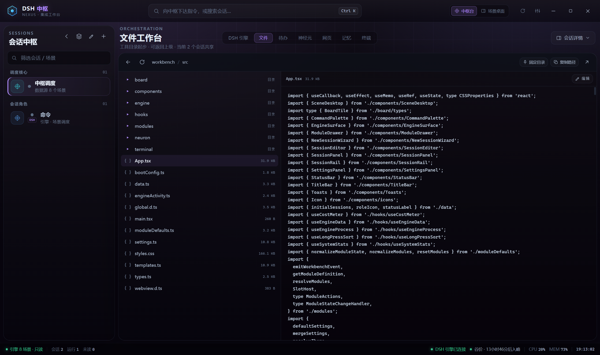

# DSH 中枢 · 文档目录

这里放的是工作台的使用说明、DSH 插件依赖、面向 AI Agent 的一键部署流程，以及项目的结构说明。根目录的 [README](../README.md) 只负责介绍项目与快速启动，细节都在本目录。



## 先看哪一篇

| 文档 | 适合谁 | 内容 |
| --- | --- | --- |
| [使用流程](usage.md) | 第一次打开工作台的人 | 中枢台、场景桌面、盒子、会话绑定、设置和常见操作 |
| [DSH 引擎与插件](engine-and-plugins.md) | 准备接入引擎的人 | 引擎目录约定、托管启动方式、dsh-collab 安装与验证 |
| [Agent 一键部署](agent-setup.md) | 让 AI Agent 代劳的人 | 从空机器到可用工作台的完整执行清单 |
| [项目结构](architecture.md) | 想改代码或做二次开发的人 | 进程模型、模块系统、IPC、存档与安全边界 |

## 它是什么

DSH 中枢是一个 Electron + React 的本地桌面工作台。它不自己实现 AI 对话，而是把本机的 DSH 引擎、会话、记忆、技能和常用工具投射到一块可编排的桌面上：

- **中枢台**：左侧会话，中间是引擎、文件、待办、神经元、网页、记忆、终端等视图。
- **场景桌面**：每个会话对应一块独立桌面，用盒子自由拼装工作区。
- **DSH 托管**：工作台负责拉起 `dsh web --no-open --port 3083`，退出时收掉。
- **本地优先**：状态、布局、主题都存在本机，不依赖云端账号。

## 三个必要前提

1. **Node.js 20+**：构建和启动工作台需要。
2. **可运行的 DSH 引擎**：工作台只带外壳，不带引擎本体；引擎需要有 `apps/cli/lib/bin.js`。
3. **[dsh-collab](https://github.com/sessionhive/dsh-collab) 插件（协作功能必装）**：会话协作、角色卡、记忆归档、工单与技能索引都来自这个插件。不装时工作台仍可启动，文件、终端、网页和待办可用，但引擎协作相关面板会是空的。

## 最快路径

```powershell
git clone https://github.com/sessionhive/dsh-workbench.git workbench
cd workbench
npm install
npm run build
npm start
```

首次启动后：

1. 打开「设置 → 引擎」，确认引擎安装目录、数据目录和工作区路径。
2. 看到状态栏显示「DSH 引擎已连接」后再开始使用。
3. 按 [engine-and-plugins.md](engine-and-plugins.md) 安装 dsh-collab，并重启一次引擎。
4. 回到「设置 → 体检」，确认「核心插件」分组没有异常。

> 工作台默认按「程序位置的上一级」推导引擎目录。把仓库克隆到 `<root>/workbench`，并让 `<root>/engine` 与 `<root>/engine-data/.dsh` 分别存在，即可直接使用默认值；否则用设置页或环境变量覆盖。

## 仓库

- 代码：<https://github.com/sessionhive/dsh-workbench>
- 协作插件：<https://github.com/sessionhive/dsh-collab>

## 许可证

MIT，详见根目录 [LICENSE](../LICENSE)。
