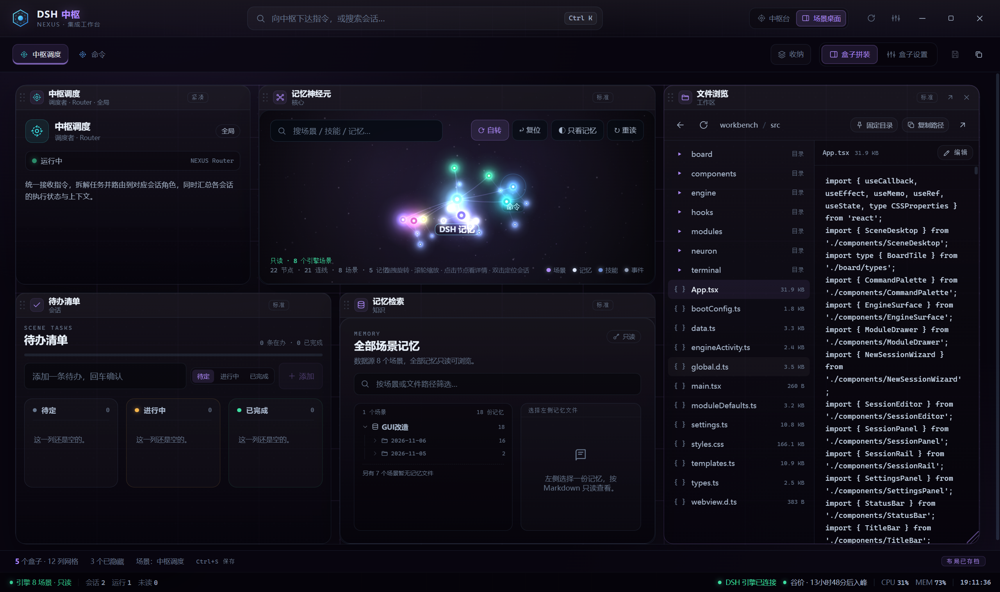

# 使用流程

这篇文档按“第一次打开工作台 → 日常使用”的顺序走一遍。看得懂界面就能直接用，不需要先读源码。



## 1. 第一次启动

### 1.1 启动前确认

- Node.js 20 或更高版本。
- DSH 引擎已经能独立运行。
- 依赖已经安装并构建过：`npm install && npm run build`。
- 端口 `3083` 没有被另一个 DSH 实例占用。

启动：

```powershell
npm start
```

工作台会自己拉起 `dsh web --no-open --port 3083`，抓取它输出的本地地址并嵌进「DSH 引擎」盒子。关闭工作台时，这个子进程会一起收掉。

### 1.2 配置引擎路径

打开顶栏右侧的设置按钮，切到「引擎」页签，确认四项路径：

| 设置项 | 作用 | 判断标准 |
| --- | --- | --- |
| 引擎安装目录 | 找到 DSH CLI | 目录下存在 `apps/cli/lib/bin.js` |
| 引擎数据目录 | 读取场景、角色、记忆、技能 | 目录下存在 `_meta/registry.json` |
| 工作区目录 | 终端和部分场景的默认工作目录 | 通常是你的代码目录 |
| 文件浏览根目录 | 文件工作台的边界 | 不应指向包含密钥的目录 |
| 技能目录 | 读取 `SKILL.md` | 默认是 `<数据目录>/skills` |
| 工具目录 | 工具页签的扫描范围 | 默认是 `<程序根>/tools` |

默认值按“程序所在位置”推导。推荐把仓库放在 `<root>/workbench`，并让 `<root>/engine` 和 `<root>/engine-data/.dsh` 存在，这样不用手填。

如果目录不在默认位置，也可以不改设置，直接用环境变量：

```powershell
$env:DSH_ENGINE_DIR = "D:\DSH\engine"
$env:DSH_HOME = "D:\DSH\engine-data\.dsh"
$env:DSH_PORT = "3083"
npm start
```

### 1.3 确认连接状态

底栏左侧会显示引擎读取结果，右侧显示托管进程状态：

- `DSH 引擎已连接`：可以正常使用引擎视图。
- `DSH 引擎启动中`：等它完成，通常需要几秒。
- `DSH 引擎未连接`：把鼠标移到状态上能看到具体错误，常见原因是路径不对或端口被占用。

顶栏的刷新按钮会重新扫描引擎数据，不会重启引擎进程。

## 2. 中枢台

中枢台是默认模式，由左侧会话栏、中间视图和顶栏/底栏组成。

### 2.1 会话栏

- 顶部搜索框按名称、角色或场景筛选会话。
- 点击会话切换当前工作对象。
- 「新建」打开模板向导；「编辑」修改当前会话的身份与装配。
- 「模块」打开模块面板，调整当前会话启用了哪些能力。
- 小箭头折叠/展开会话栏，给中间视图腾出宽度。
- 会话支持长按拖拽排序，顺序会保存到本地存档。

### 2.2 中心视图

中间顶部的分段按钮是当前会话启用的视图模块。内置模块：

| 视图 | 说明 |
| --- | --- |
| DSH 引擎 | 内嵌官方 Harness 页面；场景绑定了 Harness 会话时会自动跳转 |
| 文件 | 浏览文件根目录，预览/编辑/保存文本，可把当前目录固定到场景 |
| 待办 | 场景本地待办：待定、进行中、已完成、回收 |
| 神经元 | 3D 星图式展示场景、技能、记忆与事件，支持搜索、旋转、缩放和定位 |
| 网页 | 多标签浏览，常用地址可固定，标签切换不重载 |
| 记忆 | 按场景浏览 [dsh-collab](https://github.com/sessionhive/dsh-collab) 写入的记忆文件，只读 Markdown 预览 |
| 终端 | 常用指令、历史指令与真实 shell 三区布局，支持多开 |

视图的启用与排序在「模块」面板里调整。长按分段按钮可以拖拽排序。

### 2.3 会话详情

顶栏右侧的「会话详情」是一个下拉浮层，不占工作区宽度。里面按当前会话展示角色卡、技能、上一轮总结等引擎文档。内容来自 DSH 数据目录，默认只读；只有角色卡和 `SKILL.md` 允许在工作台里写回。

点击浮层外部或按 `Esc` 收起。

### 2.4 指令面板

按 `Ctrl + K` 或点击顶栏中间的搜索条打开指令面板。它可以：

- 切换会话；
- 打开某个视图；
- 启停当前会话的模块；
- 打开新建会话、模块装配、设置；
- 重新扫描引擎数据；
- 切换中枢台 / 场景桌面。

它是一个操作入口，不是聊天输入框。真正的对话在「DSH 引擎」视图里进行。

### 2.5 新建与编辑会话

「新建会话」弹窗按模板装配身份：

1. 选择内置模板、自定义模板或引擎场景。
2. 填写名称、角色、场景、摘要和颜色/图标。
3. 如果选了引擎场景，可以绑定一个已有的 Harness 会话；绑定后打开该场景的 DSH 页签或盒子会自动跳转。
4. 选择初始启用的模块。
5. 创建。

引擎场景创建后是只读引用；需要改装配时，可以「另存为模板」再编辑。自定义模板只保存装配，不会追改已经创建的会话。

## 3. 场景桌面

场景桌面把“当前会话”变成一块可拼装的桌面。顶栏的「中枢台 / 场景桌面」按钮随时切换。

### 3.1 场景标签

- 每个场景一个标签，最左侧固定是「中枢调度」。
- 标签支持长按拖拽排序。
- 标签太多时，超出上限的场景会自动进入「收纳」。
- 点「收纳」只弹出一个跳转列表，不会自动把场景塞回标签栏；这样标签不会越用越满。
- 收纳只影响场景桌面的标签显示，不影响左侧会话栏。

### 3.2 拼装盒子

进入场景桌面后，默认是「盒子拼装」模式：

1. 用「盒子设置」里的「可用盒子」把模块加到桌面。
2. 拖动盒子标题栏换位。
3. 拖盒子右下角把手调整宽高。
4. 双击标题栏进入专注模式，再双击或点右上角按钮退出。
5. 点右上角关闭按钮只隐藏盒子，不会删除；可以在「盒子设置」里重新显示。
6. 拖到画布上下边缘时画布会自动滚动，盒子可以一路拖到可视区之外。
7. 布局改动后按 `Ctrl + S` 或点顶栏保存按钮；有未保存改动时保存按钮才会亮起。

场景桌面的网格是 12 列，行高固定；盒子尺寸按列/行计算。

### 3.3 盒子设置

「盒子设置」左边是桌面盒子和可用盒子，右边只预览桌面上的盒子：

- 开关控制显示/隐藏。
- 隐藏的盒子重新显示后会落到桌面最下方，不会盖住现有布局。
- 长按预览里的盒子可以拖动换位，拖右下角把手改尺寸，松手立即保存。
- 模块在会话里被停用时，会显示「启用」按钮；启用后盒子才会回到桌面。
- 「全部显示」可以一次恢复所有隐藏盒子。
- 删除盒子只从当前桌面移除，不删除模块本身。

### 3.4 场景与 DSH 会话

场景可以绑定一个 Harness 会话。绑定后：

- 打开该场景的「DSH 引擎」视图或盒子时，会自动切到对应会话。
- 引擎侧栏标题变化时，工作台按标题匹配场景；如果 DSH 页面结构大改，可能需要重新绑定。

## 4. 设置

设置面板分为八个页签：

| 页签 | 用途 |
| --- | --- |
| 主题 | 七套内置主题；可新建自定义主题并随存档保存 |
| 界面 | 密度、动画、启动动画风格与速度 |
| 引擎 | 引擎安装目录、数据目录、工作区、文件根、技能/工具目录，以及只读开关 |
| 终端 | 默认 shell：自动、Git Bash、PowerShell、CMD |
| 体检 | 工作台运行时、模块注册表、路径、引擎、核心插件、技能索引、计费账本等检查 |
| 技能 | 扫描技能目录，预览 `SKILL.md` |
| 工具 | 扫描工具目录 |
| 存档 | 查看当前状态文件位置与存档信息 |

体检里的「核心插件」分组会检查 `_meta/plugin-manifest.json`、`collab/` 协作条目、技能索引等内容。装了 dsh-collab 之后，这里是最快的确认入口。

## 5. 日常建议流程

1. 启动工作台，确认底栏显示引擎已连接。
2. 在会话栏创建或选择一个场景会话。
3. 进入场景桌面，用「盒子设置」拼出这个场景的工作区：引擎 + 文件 + 终端 + 待办，或按需加入网页/记忆/神经元。
4. 调整布局后按 `Ctrl + S` 保存。
5. 在 DSH 引擎视图里工作；需要查文件、跑命令、记待办时切到对应盒子。
6. 收工前打开「设置 → 体检」，确认没有路径或插件异常。

## 6. 数据、备份与恢复

- 工作台状态：`%APPDATA%/DSH-Workbench/workbench-state.json`。
- 如果该目录不可写，会退回项目内 `.data/`。
- 状态文件包含会话、布局、主题、路径设置和模块状态，不包含引擎的模型凭据。
- 备份时直接复制这个 JSON 文件即可；恢复时退出工作台后覆盖。
- 引擎数据、角色卡、记忆和协作工单在 DSH 数据目录中，由 DSH 和 dsh-collab 管理，工作台不接管。

## 7. 常见问题

**引擎一直显示未连接。**
先看「设置 → 引擎」的安装目录是否存在 `apps/cli/lib/bin.js`，再看端口 `3083` 是否被别的 DSH 占用。端口冲突时用 `DSH_PORT` 换端口，或先关掉外部启动的 DSH。

**引擎页面白屏或停在 Loading plugins。**
通常是引擎自己还没加载完，或插件配置有误。先等几秒；仍然白屏时打开「设置 → 体检」，并检查 dsh-collab 的安装与 `cordis.patch.yml`。

**记忆、技能或协作面板是空的。**
这些数据来自 [dsh-collab](https://github.com/sessionhive/dsh-collab)。按 [engine-and-plugins.md](engine-and-plugins.md) 安装插件并重启引擎。

**场景桌面只有空白网格。**
场景默认不带盒子，这是设计行为。进入「盒子设置」添加需要的模块。

**布局没有保存。**
场景桌面的布局改动需要 `Ctrl + S`；盒子设置里的拖动和缩放会立即保存。

**文件工作台看不到某个目录。**
文件浏览被限制在「设置 → 引擎」的文件根目录内，超出范围的路径会被拒绝。这是安全边界，不是 bug。
