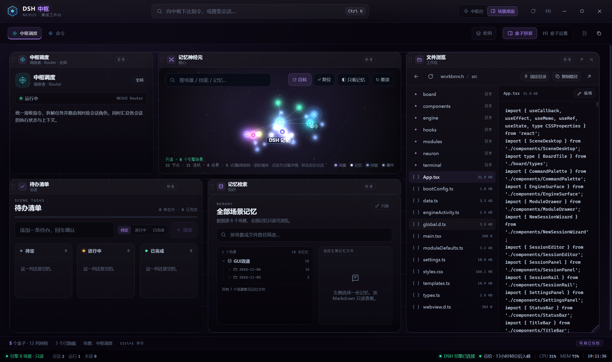
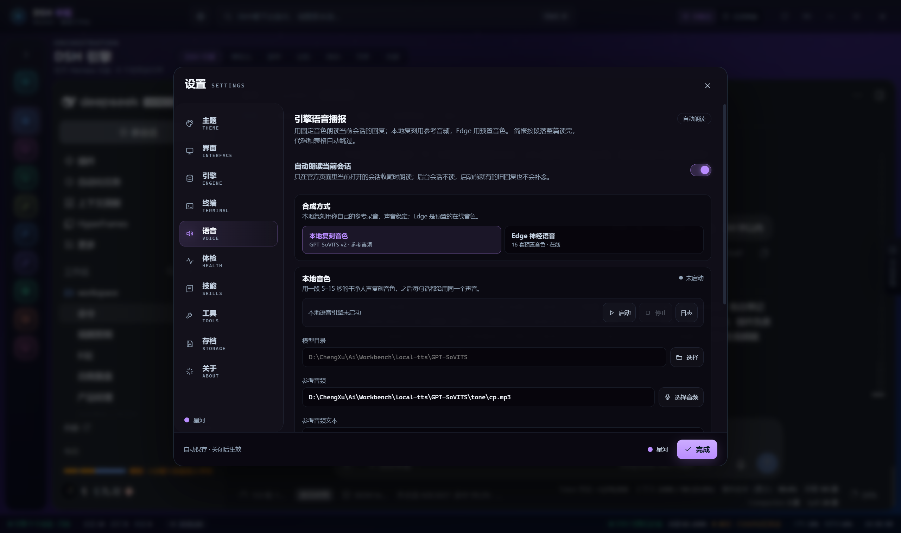

# 使用流程

这篇文档按“第一次打开工作台 → 日常使用”的顺序走一遍。看得懂界面就能直接用，不需要先读源码。



## 1. 第一次启动

### 1.1 启动前确认

- Node.js 20 或更高版本。
- DSH 引擎已经能独立运行。
- 依赖已经安装并构建过：`npm install && npm run build`。
- 端口 `3083` 没有被另一个 DSH 实例占用。

启动：

```powershell
npm start
```

工作台会自己拉起 `dsh web --no-open --port 3083`，抓取它输出的本地地址并嵌进「DSH 引擎」盒子。关闭工作台时，这个子进程会一起收掉。

### 1.2 配置引擎路径

打开顶栏右侧的设置按钮，切到「引擎」页签，确认四项路径：

| 设置项 | 作用 | 判断标准 |
| --- | --- | --- |
| 引擎安装目录 | 找到 DSH CLI | 目录下存在 `apps/cli/lib/bin.js` |
| 引擎数据目录 | 读取会话、角色、记忆、技能 | 目录下存在 `_meta/registry.json` |
| 工作区目录 | 终端和部分会话的默认工作目录 | 通常是你的代码目录 |
| 文件浏览根目录 | 文件工作台的边界 | 不应指向包含密钥的目录 |
| 技能目录 | 读取 `SKILL.md` | 默认是 `<数据目录>/skills` |
| 工具目录 | 工具页签的扫描范围 | 默认是 `<程序根>/tools` |

默认值按“程序所在位置”推导。推荐把仓库放在 `<root>/workbench`，并让 `<root>/engine` 和 `<root>/engine-data/.dsh` 存在，这样不用手填。

如果目录不在默认位置，也可以不改设置，直接用环境变量：

```powershell
$env:DSH_ENGINE_DIR = "D:\DSH\engine"
$env:DSH_HOME = "D:\DSH\engine-data\.dsh"
$env:DSH_PORT = "3083"
npm start
```

### 1.3 确认连接状态

底栏左侧会显示引擎读取结果，右侧显示托管进程状态：

- `DSH 引擎已连接`：可以正常使用引擎视图。
- `DSH 引擎启动中`：等它完成，通常需要几秒。
- `DSH 引擎未连接`：把鼠标移到状态上能看到具体错误，常见原因是路径不对或端口被占用。

顶栏的刷新按钮会重新扫描引擎数据，不会重启引擎进程。

## 2. 中枢台

中枢台是默认模式，由左侧会话栏、中间视图和顶栏/底栏组成。

### 2.1 会话栏

- 顶部搜索框按名称筛选会话。
- 点击会话切换当前工作对象。
- 「新建」打开模板向导；「编辑」修改当前会话的身份与装配。
- 「模块」打开模块面板，调整当前会话启用了哪些能力。
- 小箭头折叠/展开会话栏，给中间视图腾出宽度。
- 会话支持长按拖拽排序，顺序会保存到本地存档。

### 2.2 中心视图

中间顶部的分段按钮是当前会话启用的视图模块。内置模块：

| 视图 | 说明 |
| --- | --- |
| DSH 引擎 | 内嵌官方 Harness 页面；会话绑定了 Harness 会话时会自动跳转 |
| 文件 | 浏览文件根目录，Markdown 渲染预览、HTML 按本地页面加载（样式与脚本生效），点「编辑」才显示原文；可把当前目录固定到会话 |
| 待办 | 会话本地待办：待定、进行中、已完成、回收 |
| 神经元 | 3D 星图式展示会话、技能、记忆与事件，支持搜索、旋转、缩放和定位 |
| 网页 | 多标签浏览，固定站点全局共享、所有场景通用，标签切换不重载 |
| 记忆 | 按会话浏览 [dsh-collab](https://github.com/sessionhive/dsh-collab) 写入的记忆文件，只读 Markdown 预览 |
| 终端 | 常用指令、历史指令与真实 shell 三区布局，支持多开 |
| 派单 | 只读查看插件派单：PD 单有受理回执、接力流程与验收；TZ 通知按天分组，只发不回执，从页头信封按钮展开，支持一键已读（已读只记本机，不再显示） |
| 运行 | DSH 进程状态与端口、CPU/内存、引擎扫描统计和最近一次体检结果 |

视图的启用与排序在「模块」面板里调整。长按分段按钮可以拖拽排序。

### 2.3 浏览器收纳

顶栏搜索框左侧的圆形按钮是独立地址册，和「网页」模块的固定站点互不影响，也不随会话切换。

- 打开后是地址清单，内置常用网页 AI；标题右侧显示地址数与置顶数量。
- 每行四个操作：点击打开二级浏览器窗口、图钉置顶到最前、垃圾桶彻底释放、`×` 从收纳删除。
- 二级窗口点「关闭」只挂起，页面状态和登录保留，下次点击恢复；「彻底释放」才会销毁并重新加载。
- 窗口支持拖动、右下角缩放、双击标题栏放大；页面里的 `target=_blank` 会打开成「临时窗口」，同样可以挂起或释放。
- 浮层点外部或按 `Esc` 收起。新增地址只接受 http(s)，裸域名会自动补 `https://`，重复地址会提示。

### 2.4 会话详情

会话详情贴在窗口右边沿：收起时只留一个竖向把手，点击后向左展开成抽屉，中枢台和会话桌面共用这一个入口。里面按当前会话展示角色卡、技能、上一轮总结等引擎文档。内容来自 DSH 数据目录，默认只读；只有角色卡和 `SKILL.md` 允许在工作台里写回。

抽屉展开时会盖住右侧内容但不改变布局宽度，点外部、按 `Esc` 或点右上角关闭都会收回到右边沿。抽屉打开时另有一层透明点击层，点内嵌 webview 也能直接收起，不必先点回宿主页面。

### 2.5 指令面板

按 `Ctrl + K` 或点击顶栏中间的搜索条打开指令面板。它可以：

- 切换会话；
- 打开某个视图；
- 启停当前会话的模块；
- 打开新建会话、模块装配、设置；
- 重新扫描引擎数据；
- 切换中枢台 / 会话桌面。

它是一个操作入口，不是聊天输入框。真正的对话在「DSH 引擎」视图里进行。

### 2.6 新建与编辑会话

「新建会话」弹窗按模板装配身份：

1. 选择内置模板、自定义模板或引擎会话。
2. 填写会话名称。
3. 如果选了引擎会话，可以绑定一个已有的 Harness 会话；绑定后打开该会话的 DSH 页签或盒子会自动跳转。
4. 选择初始启用的模块。
5. 创建。

角色与模型由 DSH 引擎侧管理，工作台只维护会话名与模块装配。

引擎会话创建后是只读引用；需要改装配时，可以「另存为模板」再编辑。自定义模板只保存装配，不会追改已经创建的会话。

## 3. 会话桌面

会话桌面把“当前会话”变成一块可拼装的桌面。顶栏的「中枢台 / 会话桌面」按钮随时切换。

### 3.1 会话标签

- 每个会话一个标签，最左侧固定是「中枢调度」。
- 标签支持长按拖拽排序。
- 标签太多时，超出上限的会话会自动进入「收纳」。
- 点「收纳」只弹出一个跳转列表，不会自动把会话塞回标签栏；这样标签不会越用越满。
- 收纳只影响会话桌面的标签显示，不影响左侧会话栏。

### 3.2 拼装盒子

进入会话桌面后，默认是「盒子拼装」模式：

1. 用「盒子设置」里的「可用盒子」把模块加到桌面。
2. 拖动盒子标题栏换位。
3. 拖盒子右下角把手调整宽高。
4. 双击标题栏进入专注模式，再双击或点右上角按钮退出。
5. 点右上角关闭按钮会把盒子从桌面移除，不会删除模块本身；可以在「盒子设置」的「可用盒子」里重新添加。
6. 拖到画布上下边缘时画布会自动滚动，盒子可以一路拖到可视区之外。
7. 布局改动后按 `Ctrl + S` 或点顶栏保存按钮；有未保存改动时保存按钮才会亮起。

会话桌面的网格是 12 列，行高固定；盒子尺寸按列/行计算。一块屏幕按 12 列 × 9 行计算，盒子设置里的预览会以这个尺寸为基线。

### 3.3 盒子设置

「盒子设置」左边是桌面盒子和可用盒子，右边只预览桌面上的盒子：

- 顶部提供「全部添加」与「全部移除」：前者把可用盒子和会话里还没上桌的模块一次加到桌面，后者把桌面盒子全部收进「可用盒子」。
- 添加的盒子按顺序落到桌面最下方，不会盖住现有布局。
- 选中盒子后按 `Backspace` 或 `Delete` 可直接移除；移除的盒子回到「可用盒子」，尺寸和配置仍保留。
- 右边预览默认按一屏 12 × 9 显示，超出时用一条高亮虚线标出「一屏 · 12 × 9」。
- 长按预览里的盒子可以拖动换位，拖右下角把手改尺寸，松手立即保存。
- 模块在会话里被停用时，会显示「启用」按钮；启用后盒子才会回到桌面。
- 移除盒子只从当前桌面收起，不删除模块本身。

### 3.4 会话与 DSH 会话

会话可以绑定一个 Harness 会话。绑定后：

- 打开该会话的「DSH 引擎」视图或盒子时，会自动切到对应会话。
- 引擎侧栏标题变化时，工作台按标题匹配会话；如果 DSH 页面结构大改，可能需要重新绑定。

## 4. 设置

设置面板分为十个页签：

| 页签 | 用途 |
| --- | --- |
| 主题 | 十套内置主题（含星河、纸稿、琉璃）；新建自定义主题时可以先选一个已有主题当模板，再从「标准 / 纸稿 / 粗野 / 终端 / 柔光 / 玻璃」六种风格里挑，并逐项微调圆角（跟随 / 标准 / 直角 / 圆润）、纹理（含星空）、字体、阴影与标题栏；文字色可跟随背景亮度自动选白 / 黑，也可以手动固定。背景支持纯色、双色 / 三色渐变，也可以选一张贴纸或一段视频作背景，并调遮罩浓度与模糊，随存档保存 |
| 界面 | 密度、动画、启动动画风格与速度 |
| 引擎 | 引擎安装目录、数据目录、工作区、文件根、技能/工具目录，以及只读开关 |
| 终端 | 默认 shell：自动、Git Bash、PowerShell、CMD |
| 语音 | 两种合成方式：本地复刻音色（GPT-SoVITS v2，用一段参考录音固定音色）和四套 Edge 神经音色；支持自动朗读、语速、音量、试听，以及本地模型的启动 / 停止与日志 |
| 体检 | 工作台运行时、模块注册表、路径、引擎、核心插件、技能索引、计费账本等检查 |
| 技能 | 扫描技能目录，预览 `SKILL.md` |
| 工具 | 上半段是工作台能力模块；下半段只读扫描工具目录里的脚本，摘要取 README 或脚本头部注释 |
| 存档 | 查看当前状态文件位置与存档信息 |
| 关于 | 版本号、GitHub 仓库与文档入口，以及给项目点星的入口 |

主题改动点「保存并应用」会立即应用并写入存档；编辑中的主题直接点「完成」也会先保存再关闭，只有「取消」或 Esc 才丢弃草稿。新建主题前可以在标题右侧选一个已有主题当模板，自定义主题也会出现在模板列表里。背景素材通过系统文件选择器挑选，只登记本机绝对路径，图片支持 jpg/png/webp/gif/avif，视频支持 mp4/webm/mov 等。



语音播报只读当前打开的引擎会话的最新一轮回复：回复收尾后自动朗读，启动前就有的旧回复不会补念；长简报按段落整篇读完，代码块、表格和链接会被跳过。想重听或手动读简报，点底栏左下角的「朗读回复」，只读最新一轮；朗读时同一位置显示进度，可暂停、继续或停止，新的回复会打断旧的。合成结果按段缓存在本机，同一段回复重复朗读不再重新合成；浏览器预览环境不启用语音。

「合成方式」里有两种音色：

- **本地复刻音色**：走本机的 GPT-SoVITS v2。把模型根目录指向 `local-tts/GPT-SoVITS`（留空就用默认目录），选一段 5–15 秒的干净人声录音，再把录音里说的话逐字填进「参考音频文本」。之后每次朗读都是这一个声音，参考音频只在本机读取，不会上传。首次朗读会启动本地服务并加载模型，约 1–2 分钟；空闲 30 分钟自动卸载，加载后占用显存约 1.5 GB。合成一段的时间约为这段播放时长的三分之二，程序会边合成边播报，第一段通常在几十秒内出声；长简报按 180 字左右一段排队读完。语音页上有「启动 / 停止 / 日志」，模型起不来时先看日志。
- **Edge 神经语音**：16 套预置音色，按普通话（晓晓 / 晓伊 / 云希 / 云健 / 云扬 / 云夏）、方言（晓北 / 晓妮）、台湾（晓臻 / 晓雨 / 云哲）、粤语（晓佳 / 晓曼 / 云龙）和多语种（Ava / Andrew）分组。选定后每次朗读都是同一个声音，不需要 API Key，但需要联网；多语种音色读中文会带一点口音。

语速和音量在同一页调，改完点「朗读示例」就能直接听。本地音色不出网；Edge 音色需要联网，合成结果同样按段缓存在本机。

体检里的「核心插件」分组会检查 `_meta/plugin-manifest.json`、`collab/` 协作条目、技能索引等内容。装了 dsh-collab 之后，这里是最快的确认入口。

## 5. 日常建议流程

1. 启动工作台，确认底栏显示引擎已连接。
2. 在会话栏创建或选择一个会话。
3. 进入会话桌面，用「盒子设置」拼出这个会话的工作区：引擎 + 文件 + 终端 + 待办，或按需加入网页/记忆/神经元。
4. 调整布局后按 `Ctrl + S` 保存。
5. 在 DSH 引擎视图里工作；需要查文件、跑命令、记待办时切到对应盒子。
6. 收工前打开「设置 → 体检」，确认没有路径或插件异常。

## 6. 数据、备份与恢复

- 工作台状态：Windows 为 `%APPDATA%/DSH-Workbench/workbench-state.json`，Linux 为 `~/.config/DSH-Workbench/workbench-state.json`。
- 如果该目录不可写，会退回项目内 `.data/`。
- 状态文件包含会话、布局、主题、路径设置和模块状态，不包含引擎的模型凭据。
- 备份时直接复制这个 JSON 文件即可；恢复时退出工作台后覆盖。
- 引擎数据、角色卡、记忆和协作工单在 DSH 数据目录中，由 DSH 和 dsh-collab 管理，工作台不接管。

## 7. 常见问题

**引擎一直显示未连接。**
先看「设置 → 引擎」的安装目录是否存在 `apps/cli/lib/bin.js`，再看端口 `3083` 是否被别的 DSH 占用。端口冲突时用 `DSH_PORT` 换端口，或先关掉外部启动的 DSH。

**引擎页面白屏或停在 Loading plugins。**
通常是引擎自己还没加载完，或插件配置有误。先等几秒；仍然白屏时打开「设置 → 体检」，并检查 dsh-collab 的安装与 `cordis.patch.yml`。

**记忆、技能或协作面板是空的。**
这些数据来自 [dsh-collab](https://github.com/sessionhive/dsh-collab)。按 [engine-and-plugins.md](engine-and-plugins.md) 安装插件并重启引擎。

**会话桌面只有空白网格。**
会话默认不带盒子，这是设计行为。进入「盒子设置」添加需要的模块。

**布局没有保存。**
会话桌面的布局改动需要 `Ctrl + S`；盒子设置里的拖动和缩放会立即保存。

**文件工作台看不到某个目录。**
文件浏览被限制在「设置 → 引擎」的文件根目录内，超出范围的路径会被拒绝。这是安全边界，不是 bug。
