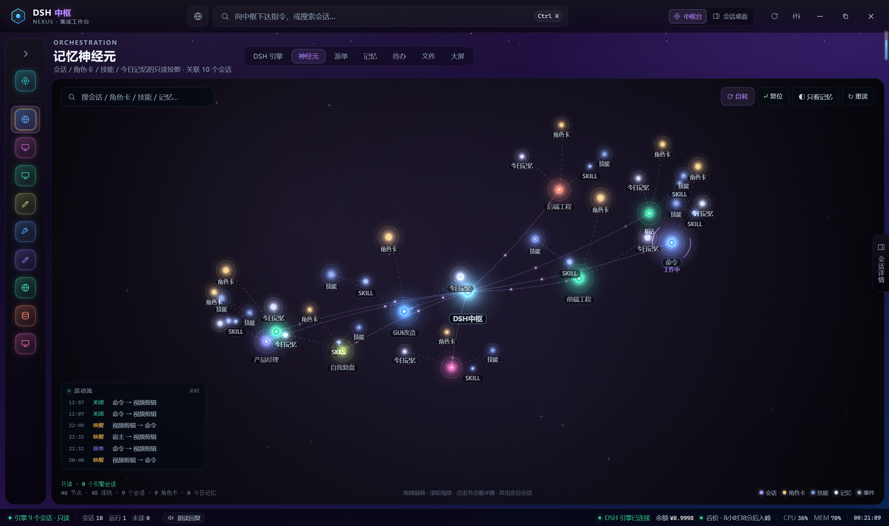

# DSH 中枢 · 文档索引

工作台的使用说明、引擎与插件依赖、一键部署、Linux 打包和项目架构都在这里。根目录的 [README](../README.md) 只介绍项目、截图和快速启动。



## 先看哪一篇

| 文档 | 适合谁 | 内容 |
| --- | --- | --- |
| [一键部署](一键部署.md) | 刚克隆仓库、想直接跑起来的人 | 运行 `scripts/setup.mjs`，自动建目录、装引擎、装插件 |
| [使用说明](使用说明.md) | 第一次打开工作台的人 | 中枢台、会话桌面、盒子、新建会话、设置与日常操作 |
| [引擎与插件](引擎与插件.md) | 准备接入已有引擎的人 | 引擎目录约定、托管启动、dsh-collab 安装与验证 |
| [项目架构](项目架构.md) | 想改代码或做二次开发的人 | 进程模型、模块系统、IPC、存档与安全边界 |
| [Linux 使用与打包](Linux使用与打包.md) | 在 Linux 上安装、运行或打包的人 | AppImage/deb、路径默认值、Bash/Zsh 终端、端口排查与 CI |

## 它是什么

DSH 中枢是一个 Electron + React 的本地桌面工作台。它不自己实现 AI 对话，而是把本机的 DSH 引擎、会话、记忆、技能和常用工具投射到一块可编排的桌面上：

- **中枢台**：左侧会话，中间是引擎、文件、待办、神经元、网页、记忆、终端等视图。
- **会话桌面**：每个会话一块 12 列网格桌面，用盒子自由拼装工作区。
- **DSH 托管**：工作台负责拉起 `dsh web --no-open --port 3083`，退出时收掉。
- **浏览器收纳**：顶栏独立地址册，二级窗口关闭后只挂起、保留页面状态，彻底释放才重新加载。
- **本地优先**：状态、布局、主题都存在本机，不依赖云端账号。

## 三个必要前提

1. **Node.js 20+**：构建和启动工作台需要。
2. **可运行的 DSH 引擎**：工作台只带外壳，不带引擎本体；引擎需要有 `apps/cli/lib/bin.js`。没有引擎时，一键脚本会自动下载。
3. **[dsh-collab](https://github.com/sessionhive/dsh-collab) 插件（协作功能必装）**：会话协作、角色卡、记忆归档、工单与技能索引都来自这个插件。不装时工作台仍可启动，文件、终端、网页和待办可用，但引擎协作相关面板会是空的。一键脚本会强制安装。

## 最快路径

```powershell
git clone https://github.com/sessionhive/dsh-workbench.git app
cd app
node scripts/setup.mjs
```

Windows 也可以双击 `scripts\setup.cmd`。先看会做什么、不写文件：

```powershell
node scripts/setup.mjs --dry-run
```

脚本会创建同级目录、安装并构建工作台、下载 DSH、初始化数据目录、安装 dsh-collab、更新 `cordis.patch.yml`，最后启动客户端。目录、参数和失败排查见 [一键部署](一键部署.md)。

## 首次启动后

1. 打开「设置 → 引擎」，确认引擎安装目录、数据目录和工作区路径。
2. 看到底栏显示「DSH 引擎已连接」后再开始使用。
3. 一键脚本会安装 dsh-collab；手动安装时按 [引擎与插件](引擎与插件.md) 操作，并重启一次引擎。
4. 回到「设置 → 体检」，确认「核心插件」分组没有异常。

> 工作台默认按「程序位置上一级」推导引擎目录。推荐把仓库放在 `<root>/app`，并让 `<root>/engines` 与 `<root>/data/.dsh` 分别存在，即可直接使用默认值；否则用设置页或环境变量覆盖。

## 仓库

- 代码：<https://github.com/sessionhive/dsh-workbench>
- 协作插件：<https://github.com/sessionhive/dsh-collab>

## 许可证

MIT，详见根目录 [LICENSE](../LICENSE)。